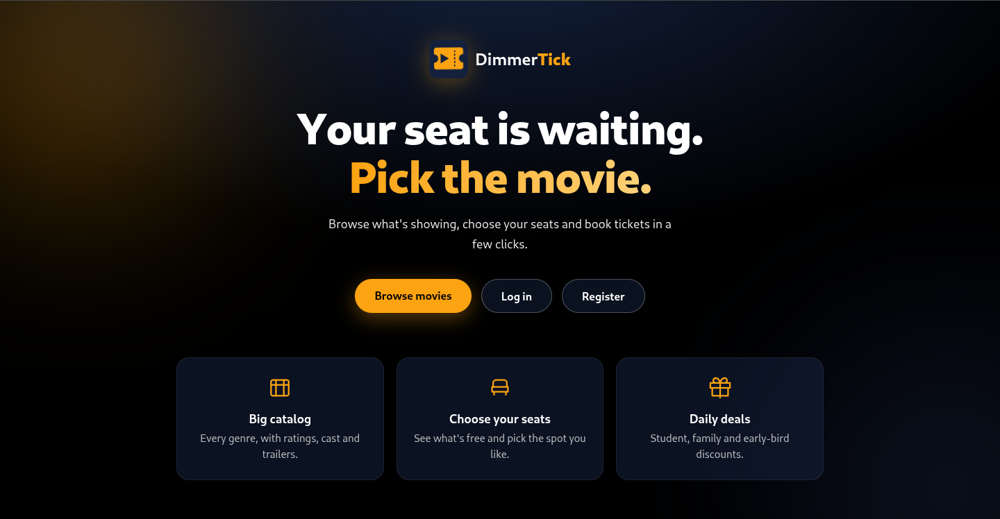
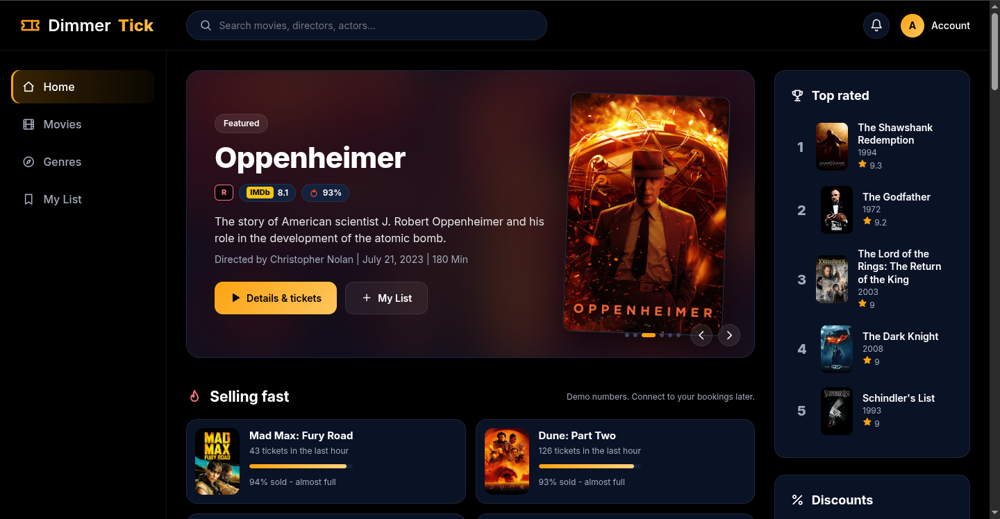
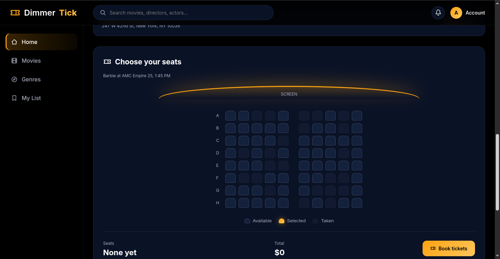
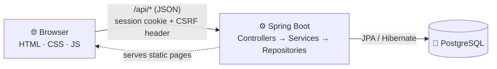

<div align="center">

# 🎟️ DimmerTick

**A movie ticket platform built with Spring Boot and vanilla JavaScript.**

[](../../releases)
[](https://openjdk.org/)
[](https://spring.io/projects/spring-boot)
[](https://www.postgresql.org/)
[](#-roadmap)

[Features](#-features) · [Screenshots](#-screenshots) · [Architecture](#-architecture) · [Getting started](#-getting-started) · [Roadmap](#-roadmap)

</div>

---

## ✨ Overview

DimmerTick is a movie browsing and ticketing site. Visitors can explore the catalogue, watch trailers,
and read details without an account. Signing in unlocks the watchlist, and booking will require an account too.

> **v0.1.0** — browsing, accounts, and watchlists work. Seat selection is a demo: nothing is saved or charged yet.

## 🚀 Features

| | Feature | Status |
|:-:|---|:-:|
| 🎬 | Browse movies, search, filter by genre | ✅ |
| 🖼️ | Hero slider, *Top rated* and *Selling fast* sections | ✅ |
| ▶️ | Movie details with embedded YouTube trailers | ✅ |
| 🔐 | Register and log in (BCrypt password hashing) | ✅ |
| 🛡️ | Session login with CSRF protection | ✅ |
| 📌 | Watchlist saved to the account | ✅ |
| 💬 | Login popup for visitors who try protected actions | ✅ |
| 👑 | Role-based access (`USER`, `ADMIN`) | ✅ |
| 🪑 | Seat map and showtimes from the database | 🚧 |
| 💳 | Booking with server-side pricing | 🚧 |
| 🧰 | Admin panel (add movies, hero, schedules) | 📋 |

✅ done · 🚧 in progress · 📋 planned

## 📸 Screenshots

<details open>
<summary><b>Home</b></summary>



</details>

<details>
<summary><b>Movies and My List</b></summary>



</details>

<details>
<summary><b>Movie details and seat selection (demo)</b></summary>



</details>

## 🧱 Architecture



| Layer | Technology |
|---|---|
| Backend | Java 25 · Spring Boot 4.1 · Spring Security · Spring Data JPA |
| Database | PostgreSQL 18 · Hibernate (`ddl-auto=update`) |
| Frontend | HTML · CSS · vanilla JavaScript, no build step |
| Security | Session cookies · BCrypt · CSRF tokens · role-based authorization |

<details>
<summary><b>📁 Project structure</b></summary>

```
Dimmertick/
├── DimmerTickBackEnd/          # Spring Boot API (Maven wrapper included)
│   └── src/main/java/…
│       ├── config/             # security, CORS, page routing
│       ├── controller/         # REST endpoints
│       ├── domain/             # entities, DTOs, enums
│       ├── exception/          # one place for all API errors
│       ├── repository/         # Spring Data JPA
│       └── service/            # business rules
└── Front-End/                  # static pages, served by the backend
    ├── css/
    └── js/
```

</details>

## 🛠️ Getting started

**Requirements:** JDK 25 · PostgreSQL 16+ · no Maven install needed (uses `./mvnw`)

<details open>
<summary><b>1️⃣ Create the database</b></summary>

```bash
sudo -u postgres psql -c 'CREATE DATABASE "DimmerTick";'
```

</details>

<details open>
<summary><b>2️⃣ Add your local settings</b></summary>

Create `DimmerTickBackEnd/src/main/resources/application-local.properties`.
This file is git-ignored; **never commit it**.

```properties
spring.datasource.url=jdbc:postgresql://localhost:5432/DimmerTick
spring.datasource.username=postgres
spring.datasource.password=your_database_password
```

</details>

<details open>
<summary><b>3️⃣ Run the backend</b></summary>

```bash
cd DimmerTickBackEnd
./mvnw spring-boot:run -Dspring-boot.run.profiles=local
```

On first start, the tables are created and the movie catalogue is loaded from `data/movies.json`.

</details>

<details open>
<summary><b>4️⃣ Open the site</b></summary>

👉 **http://localhost:8080**

Use port 8080 only. The pages call the API on the same address, so other ports won't work.

</details>

<details>
<summary><b>👑 Create an admin account</b></summary>

Register through the site, then promote the account:

```bash
sudo -u postgres psql -d DimmerTick \
  -c "UPDATE app_users SET role = 'ADMIN' WHERE email = 'you@example.com';"
```

Log out and back in so the new role takes effect.

</details>

## 🔒 Security

- 🔑 Passwords are stored as **BCrypt** hashes and never returned by the API
- 🛡️ State-changing requests require a **CSRF token** (`X-XSRF-TOKEN` header)
- 🚪 Admin routes (`/api/admin/**`, `/api/users/**`) require the `ADMIN` role
- 🙈 Secrets live in git-ignored local files or environment variables, not in the repository

## 🗺️ Roadmap

- [ ] Showtimes and seat maps served from the database
- [ ] Booking with server-side pricing (base price + seat-tier fee)
- [ ] Payment integration
- [ ] Admin panel: movies, hero slider, daily schedules
- [ ] Structured logging with rotation

## 📄 License

Not decided yet.

---

<div align="center">
Built by <b>Alireza Akhavan</b> · <a href="https://github.com/AlirezaAkhavanJava">GitHub</a> · <a href="https://www.linkedin.com/in/alireza-akhavan80">LinkedIn</a>
</div>


